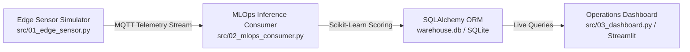

# Industrial IoT Streaming & Anomaly Detection MLOps Pipeline

An end-to-end, event-driven telemetry pipeline that simulates industrial edge sensors over **MQTT**, executes real-time **Scikit-Learn** anomaly inference in a decoupled consumer service, persists structured telemetry and anomaly flags to a **SQLAlchemy / SQLite** warehouse, and serves live diagnostics through a **Streamlit** dashboard.

## Problem Statement
Industrial assets generate continuous sensor streams where delayed anomaly detection leads to unplanned downtime. Running batch analytics over static CSV exports misses transient failures, while unlogged black-box predictions leave operations teams without an auditable trail of why an alert fired.

This prototype separates edge telemetry generation, streaming ML inference, relational warehousing, and operational monitoring into three modular Python services.

---

## System Architecture



### Core Components
* **`src/01_edge_sensor.py`:** Publishes simulated industrial sensor telemetry payloads to an MQTT broker via `paho-mqtt`.
* **`src/02_mlops_consumer.py`:** Subscribes to the live MQTT stream, evaluates incoming readings with `scikit-learn`, and persists raw features alongside anomaly verdicts via `SQLAlchemy`.
* **`src/03_dashboard.py`:** Connects to the SQL warehouse using `pandas` and `streamlit` to visualize sensor trends and flagged anomalies in real time.

---

## Quick Start

### 1. Install Dependencies
```bash
python -m venv venv
pip install -r requirements.txt
```

### 2. Launch the Pipeline (3 Terminals)
Start the consumer first so no initial sensor messages are missed:

**Terminal 1 — MLOps Inference Consumer & Warehouse Writer**
```bash
python src/02_mlops_consumer.py
```

**Terminal 2 — Edge Sensor Publisher**
```bash
python src/01_edge_sensor.py
```

**Terminal 3 — Monitoring Dashboard**
```bash
streamlit run src/03_dashboard.py
```

---

## Tech Stack
* **Messaging:** `paho-mqtt`
* **ML & Data Processing:** `scikit-learn`, `pandas`
* **Persistence:** `SQLAlchemy` (SQLite backend for zero-config local execution)
* **Visualization:** `streamlit`

## Planned Iterations
* **Explainability & Auditability:** Log feature-level contribution scores and explicit anomaly decision thresholds alongside each warehouse record.
* **Feature Selection & Containerization:** Add automated feature-selection benchmarking and Docker Compose orchestration for reproducible multi-service deployment.