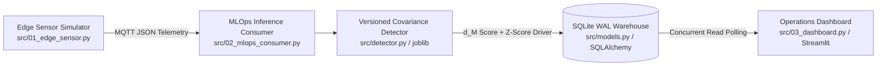
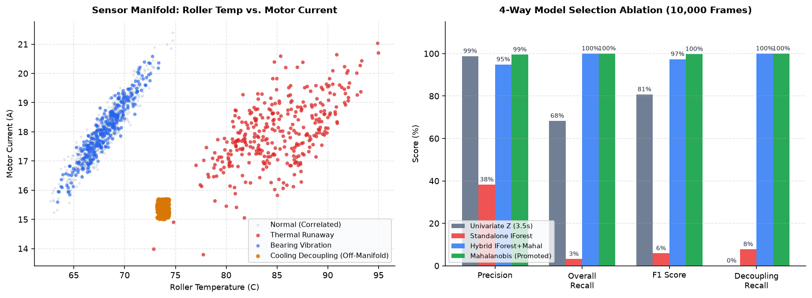

# Industrial IoT Streaming & Explainable Anomaly Detection MLOps Pipeline

An event-driven industrial telemetry pipeline that decouples **MQTT** edge streaming, sub-millisecond **covariance-aware anomaly detection** with per-feature root-cause attribution, **SQLAlchemy / SQLite (WAL)** warehousing, and real-time **Streamlit** operational diagnostics.

## Problem Statement
Industrial assets produce continuous, physically coupled sensor streams (e.g., roller temperature, mechanical vibration, and motor current rising and falling together with load). Monitoring these streams in production exposes two common failure modes:
1. **Univariate Threshold Blindness:** Fixed per-sensor limits catch gross single-axis spikes but completely miss subtle *correlation-drift* faults (such as a cooling failure where temperature rises while motor load drops, leaving every individual sensor inside normal bounds).
2. **Unvalidated Black-Box ML:** Deploying off-the-shelf tree ensembles (like `IsolationForest`) without regime-level ablation can degrade precision, miss single-axis faults due to axis-aligned split masking, and emit opaque boolean alerts without telling operators *which* sensor failed.

This clean-room prototype implements a modular streaming MLOps architecture backed by a 4-way model selection ablation, versioned `joblib` artifact persistence, SQLite WAL concurrency, and auditable root-cause logging.

---

## System Architecture



### Core Components
* **`src/detector.py`:** Fits a versioned `scikit-learn` `EmpiricalCovariance` precision matrix (`mahalanobis-cov-v2.0`) on correlated healthy baseline telemetry, scores incoming frames via Mahalanobis distance ($d_M \ge 4.2$, $\approx 99.95\%$ $\chi^2_3$ confidence boundary), and assigns an auditable `primary_driver` (`roller_temp_c`, `vibration_hz`, `motor_current_a`, `multivariate`, `correlation_drift`, or `normal`) via per-feature Z-scores.
* **`src/models.py`:** SQLAlchemy ORM (`TelemetryRecord`) configuring SQLite with `PRAGMA journal_mode=WAL` and a `5000 ms` busy timeout to prevent read/write lock contention between the streaming consumer and dashboard.
* **`src/01_edge_sensor.py` / `02_mlops_consumer.py` / `03_dashboard.py`:** Decoupled MQTT publisher, streaming inference consumer, and Streamlit monitoring UI with environment-variable broker/topic configuration and unique per-session MQTT client IDs.

---

## Empirical Validation & 4-Way Model Selection Ablation

Evaluated via `scripts/benchmark_pipeline.py` on a held-out **10,000-frame** correlated telemetry stream containing **977 injected faults** across three physical regimes:
* **Thermal Runaway:** Single-axis roller temperature surge (`+12` to `+22 °C`).
* **Bearing Vibration:** Single-axis mechanical vibration spike (`+5` to `+12 Hz`).
* **Cooling Decoupling:** Off-manifold correlation fault (elevated temperature with low load/current) where every individual sensor remains below `3.5σ`.

### Detection Performance (10,000 Frames / 977 Faults)

| Candidate Detector | Precision | Recall | F1 Score | False Positive Rate | Thermal Recall | Bearing Recall | Decoupling Recall |
| :--- | :---: | :---: | :---: | :---: | :---: | :---: | :---: |
| **Univariate Z-Score (`3.5σ`)** | `0.9881` | `0.6827` | `0.8075` | `0.09%` | `99.7%` | `100.0%` | **`0.0%`** |
| **Standalone Isolation Forest (`c=0.005`)** | `0.3827` | `0.0317` | `0.0586` | `0.55%` | `2.1%` | `0.0%` | `7.8%` |
| **Hybrid IForest + Mahalanobis** | `0.9485` | `1.0000` | `0.9736` | `0.59%` | `100.0%` | `100.0%` | `100.0%` |
| **Mahalanobis Covariance *(Promoted)*** | **`0.9949`** | **`1.0000`** | **`0.9974`** | **`0.06%`** | **`100.0%`** | **`100.0%`** | **`100.0%`** |

### Throughput & Latency Profile

| Benchmark Metric | Observed Performance |
| :--- | :--- |
| **Standalone IForest Single-Frame Latency** | P50: `7.864 ms` · P95: `12.822 ms` |
| **Promoted Mahalanobis Single-Frame Latency** | P50: **`0.0068 ms`** · P95: **`0.0154 ms`** (**1,156× faster**) |
| **Vectorized Batch Scoring (10,000 frames)** | **`6.11 ms`** (`1,637,814` frames/sec) |
| **SQLite WAL Bulk ORM Persistence (10,000 rows)** | **`472.4 ms`** (`21,168` rows/sec) |



---

## Engineering & MLOps Lessons Learned
* **Ablation-Driven Model Demotion (Why Isolation Forest Was Rejected):** An initial prototype used `IsolationForest` directly on raw 3-axis telemetry. Controlled regime benchmarking exposed severe axis-aligned split masking: single-axis spikes sat inside normal bounds on the other two axes, while off-manifold decoupling faults remained inside the marginal bounding box—leaving standalone `IsolationForest` at `0.0586` F1 while contributing `93%` of false alarms (`0.55%` of `0.59%`) in the hybrid test. Promoting `EmpiricalCovariance` Mahalanobis Distance to the active gate raised F1 to **`0.9974`**, cut FPR by **9.8×**, and accelerated per-frame inference by **1,156×**.
* **Eliminating Static Client ID Collisions & WAL Contention:** Replacing static MQTT client IDs with per-session UUID suffixes prevents silent disconnects on shared brokers, while enabling SQLite Write-Ahead Logging (`WAL`) prevents database lock errors during concurrent consumer writes and Streamlit polling.

---

## Design Trade-offs & Scope

| Subsystem | Prototype Implementation | Production-Scale Architecture |
| :--- | :--- | :--- |
| **Anomaly Model** | `EmpiricalCovariance` Mahalanobis (`d_M >= 4.2`) + Z-score driver attribution | Online rolling covariance (EWMA) or PCA-whitened ensembles for non-Gaussian/multimodal asset states |
| **Message Transport** | Configurable MQTT (`paho-mqtt`, default public HiveMQ broker) | Private TLS-authenticated EMQX / Mosquitto cluster or Redpanda/Kafka for replayable partitions |
| **Telemetry Store** | Local SQLite in WAL mode via SQLAlchemy (`21K` rows/sec bulk) | TimescaleDB / ClickHouse with retention policies and continuous aggregates |
| **Artifact Tracking** | Local versioned `joblib` bundle (`artifacts/mahalanobis_detector_v2.joblib`) | MLflow Model Registry with drift monitors and automated canary promotion |

---

## Quick Start

### 1. Install Dependencies
```bash
python -m venv venv
pip install -r requirements.txt
```

### 2. Run Automated Unit Tests & 10K Ablation Benchmark (Offline, No Broker Required)
```bash
python -m pytest -v
python -m scripts.benchmark_pipeline
```

### 3. Launch Live Streaming Pipeline (3 Terminals)
Run modules from the repository root so `src` resolves cleanly:

**Terminal 1 — MLOps Inference Consumer & SQLite WAL Writer**
```bash
python -m src.02_mlops_consumer
```

**Terminal 2 — Edge Sensor Publisher**
```bash
python -m src.01_edge_sensor
```

**Terminal 3 — Live Operations Dashboard**
```bash
python -m streamlit run src/03_dashboard.py
```

*(Override `MQTT_BROKER`, `MQTT_PORT`, `MQTT_TOPIC`, or `IOT_DB_URL` via environment variables to point at a local Mosquitto broker or external database.)*

---

## Project Structure
```text
Industrial-IoT-MLOps-Pipeline/
├── src/
│   ├── models.py               # SQLAlchemy ORM schema & SQLite WAL engine factory
│   ├── detector.py             # EmpiricalCovariance Mahalanobis detector, Z-score attribution & joblib I/O
│   ├── 01_edge_sensor.py       # MQTT edge telemetry simulator (normal + 3 physical fault regimes)
│   ├── 02_mlops_consumer.py    # Streaming inference subscriber & auditable warehouse writer
│   └── 03_dashboard.py         # Real-time Streamlit monitoring UI
├── scripts/
│   └── benchmark_pipeline.py   # 10,000-frame 4-way ablation, latency & WAL throughput benchmark
├── tests/
│   └── test_pipeline.py        # 6 offline pytest cases (fault regimes, joblib persistence, WAL writes)
├── docs/
│   └── mlops_benchmark.png     # Compact 194.8 KB manifold & 4-way ablation figure
└── requirements.txt
```

---

## References
1. Rousseeuw, P. J., & Van Driessen, K. (1999). *A Fast Algorithm for the Minimum Covariance Determinant Estimator*. Technometrics.
2. Liu, F. T., Ting, K. M., & Zhou, Z.-H. (2008). *Isolation Forest*. IEEE International Conference on Data Mining (ICDM).
3. Pedregosa, F., et al. (2011). *Scikit-learn: Machine Learning in Python*. Journal of Machine Learning Research.